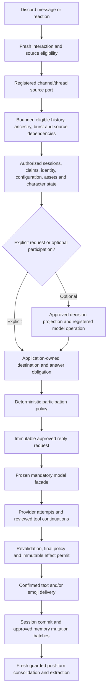

# Common chat context and model boundary: closing audit

Reviewed after checkpoint 37 (`f72c0c42`), against the original trigger/context plan, privacy gateway plan and contextual participation plan. This document describes the current local implementation. Earlier dated checkpoints and provider reports are historical evidence, not deployments or new live measurements.

## Completion and scope

The local source and consumer migration is implemented. All production Discord chat entry points use the registered source engine; all configured chat, utility, dedicated decision, image and embedding capabilities are exposed through mandatory frozen model facades. The production memory engine is also behind a frozen mandatory facade. There is no active context-free chat/model fallback selected by a missing port or legacy retrieval setting.

This scope covers Discord conversation context and the consumers listed in the AST [model inventory](model-consumer-inventory-2026-10-21.json). Campaign game-state generation is a separate subsystem and does not receive these chat source authorities. The architecture checks protect ordinary application boundaries; they are not a sandbox against intentionally malicious new JavaScript, arbitrary networking or direct database tampering.

Production deployment, independent wording/semantic review, a newly authorized paid replay and an exact-server/channel pilot remain external acceptance work. The older 216-case and 21-case provider reports cannot certify this new revision. No production setting was changed and no new paid request or Discord send was made during this completion pass.

## Current flow

All seven interactions use this lifecycle, source policy and effect boundary. A trigger decides whether/how an interaction can proceed; it grants no additional read permission. Rich context means selecting relevant authorized evidence, not loading every source on every turn.

| Interaction | Meaning and participation |
| --- | --- |
| Direct bot mention | Explicit request, application-bound destination. It can refer to earlier authorized messages. |
| Explicit reply to bot | Explicit request with independently authorized ancestry; a reply grants no access to a hidden target. |
| Bare ping | Read available conversation before interpreting the ping. A preceding untagged question can be its referent. Personality may make a genuinely social response playful; social/closing duplicates retain bounded suppression. |
| Name address | Matched addressing enters the common explicit-request path. Ambiguous identity is not authority to guess. |
| Implicit follow-up | Decision sees authorized exchange/reference anchors; policy evaluates validated recipient/contribution evidence. An earlier speaker's exchange does not automatically transfer to another person. |
| Open group conversation | Optional useful contribution or emoji/silence under configured scope, budgets and deterministic policy. No generic filler obligation. |
| Reaction to bot | Verified bot target and eligible reactors; no invented current human speaker. Hidden targets exclude their emoji context; thresholds use eligible actors. |

History uses eligible counts and bounded evidence selection. Quiet gaps alone do not make a reference irrelevant. Candidate coalescing/expiry, the 30-second turn work deadline, retention and historical relevance are separate concerns. Missing evidence requires uncertainty/clarification, not a claim that someone never spoke or lacked permission.

## Source coverage

| Source | Current guard and evidence |
| --- | --- |
| Current text, burst, history, ancestry and overflow | Registered `GuardedConversationContext`; fresh scope/author/content/access/forget checks, eligible counts, bounded targeted reads and source-owned compaction. `guarded-conversation-context`, `guarded-reply-overflow`, real Discord port/adapter tests. |
| Bot output and saved sessions | Confirmed origins, exact output/asset hashes and complete dependencies; no authority from bot identity alone. Session-only origins are ephemeral and bounded. Source deletion/change/forgetting invalidates reuse. |
| Daily summaries and extraction jobs | Registered `GuardedBackgroundContext` and closed `BackgroundModelGateway`; fresh job/source/member/audience checks on actual attempts and persistence, with approved immutable fact/relationship batches. `background-model-gateway`, channel scheduler and memory provenance tests. |
| Ordinary memories | Candidate authorization before external relevance/classification, literal human grounding, purpose/audience/isolation/subject checks, exact-text embedding receipts and immutable write batches. The production facade rejects context-free core compatibility. |
| Relationships, aliases and identity | Endpoint/support proofs, eligible actors and independently validated observed labels. No hidden intermediate graph nodes or legacy alias promotion. `guarded-memory-relations`, `guarded-observed-aliases`, `guarded-character-memory` tests. |
| Learned character state and callbacks | Source-backed `CharacterMemory`, guarded utility operations, scoped drift epochs and fresh callback evidence. Module-owned records do not enter ordinary memory recall. Global drift APIs and the obsolete window-summary cache were removed. |
| Authored ledger replacements | Settings-authorized explicit text, current persona, destination, revision fingerprint and matching admin source record. Verified parent restrictions survive; legacy text/metadata and embeddings are not promoted. A protected configuration resource invalidates old revisions. `authored-character-configuration` tests include the final generation payload. |
| Persona, lore, examples and preferences | Registered immutable configuration, fresh file/owner/fingerprint checks and closed compile/analyze/index serializers. Authored configuration is separate from learned participant claims. Configuration-only evaluation cannot import participant histories or learned state. |
| Attachments and reference images | Fresh source/actor checks, pinned asset descriptors, bounded approved Discord downloads, exact image bytes and registered image operations. No unapproved partial image previews. |
| Memory/link/server/birthday/image/music tools | Reviewed implementations and action-specific authorization, bounded guarded results, public-fetch restrictions and source/resource dependencies before provider continuations. Music uses the real command/access boundary. |
| Provider-managed public search | Effective setting and actual transport support are shared with status. Public web lineage is separate from protected Discord sources. Native provider queries are a provider-managed boundary; the application does not claim per-query interception or factual verification. |
| Indexes and caches | Source-owned queries, purpose/scope identity, guard outside result and in-flight caches, every waiter revalidated. Batch failures grant only bounded individual fallback for the original exact texts. |
| Diagnostics and delivery | Metadata-only source/decision/model/effect traces. Gate rejection records approval/source/result phase without prompts or provider-attempt inflation. Explain-message preserves recovery, partial/confirmed delivery and uncertainty. |

Unknown/unverifiable legacy records remain excluded. Cross-channel learned-data reuse remains restricted until an explicit destination-audience authorization contract exists. This is a deliberate privacy boundary, not an implicit promise that any readable server channel becomes global context. Existing retention/feature/user access settings still apply.

## Mandatory consumer boundary

`ConversationModelGateway`, `BackgroundModelGateway`, `ConfigurationModelGateway` and the reviewed character/memory/tool serializers own approved projections. Runtime registrations bind scope, purpose, payload and current source/configuration authority. The root model facade rejects raw/copied reply requests, copied utility options, modified payloads, wrong-purpose receipts and replayed operations. Raw credentials, clients and transport internals are not exposed.

The guard remains active inside utility/embedding attempts and provider reply/tool loops, and before result exposure, delivery and persistence. It cannot undo bytes already dispatched to Discord or an external provider. Source invalidation causes suppression/rebuild rather than a prompt telling the model to forget hidden data halfway through.

The three replay tools now use explicit synthetic/consented source premises. Incremental character replay retains its actual preceding reply proofs. Compiled entry points work without development `tsx`: `eval:contextual:built`, `eval:conversation:built` and `eval:character-replay:built`. Inventory/help modes perform no paid calls. A live replay still needs explicit credentials/instance and cost authorization.

Architecture tests restrict source/operation issuance, mutation approval, raw transport/core-engine construction and adapters' effect consumption. They cover static aliases, value/namespace/star re-exports, dynamic imports and require/import-equals. The inventory detects added/removed capability consumers; it is a drift detector, not the enforcement mechanism itself.

## Closing verification and limits

- Full suite: **5,116 passed, 7 skipped, zero failed**. Full TypeScript checking, production TypeScript compilation, complete Activity/application build, migration consistency, changed-file ESLint and whitespace checks passed.
- The actual adapter-to-effect suite now runs behind the production model and memory facades. Fake HTTP tests capture final serialized requests, retries and revocation behavior. SQLite tests exercise persisted facts, temporal revisions, forgetting and invalidation.
- `npm ci --dry-run --ignore-scripts --offline --no-audit --no-fund` passed against the current package/lock state. This verifies the local install plan, not a clean Linux/Alpine native-module build or the user's server. The original server excerpt omitted the preceding npm root error; no different cause is invented here.
- Both contextual and lifecycle compiled inventory commands passed without `tsx` or provider calls; character replay's compiled help entry point passed too.
- Whole-repository ESLint reports **2,145 errors in 58 files**, including 1,045 errors in generated Activity output. None of its offending files were changed by checkpoints 29–37 compared with `fbdc85b0`; the lint configuration and Activity sources are unchanged. The source changes in this migration pass their lint checks. Unrelated repository-wide lint debt remains explicit; no global lint relaxation or unrelated mass rewrite was used to obtain a green label.
- The seven skipped tests and fake transports do not establish live PostgreSQL, Discord transport or server deployment acceptance. No new paid 216-case run, independent human semantic review or production pilot is claimed.

The original plans were reread after the implementation. That reread led to mandatory utility/embedding/reply dispatch, replay migration, dead-path removal, authored ledger repair, guarded public character preparation and closed transport/diagnostic checks in checkpoints 29–37. The remaining release gates are independent semantic review, server build/deployment evidence and a named-channel pilot with an agreed measured-cost budget. Rollback may change participation policy; it must not restore raw source/model access or promote legacy data.
