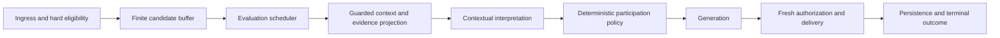

# Contextual participation improvement plan

Prepared 2026-10-21. Status: checkpoints 1–5 implemented locally behind an opt-in flow version; checkpoint 6 tooling and a 216-case real-provider replay are implemented, with semantic review and production shadow/live pilot still open. No production deployment or setting change performed. Based on the [full flow review](chat-flow-design-review-2026-10-21.md) and Pinecone deployment traces through `a2d0bdb1`. See [release evidence and rollout](contextual-participation-release-2026-10-21.md) for current limits and measured provider results.

Implementation progress: checkpoint 1 implemented locally. `flowVersion: contextual_v1` is an explicit opt-in under participation controls (legacy remains the default). It uses a strict wire contract without fixed destination IDs or legacy boundary fields, opaque selectable target keys, application-bound recipients, and valid target-free abstention. Contract/fallback/privacy tests plus settings metadata/registry tests: 58 passed; typecheck and changed-file lint passed. No live configuration changed; subsequent checkpoints and real-provider acceptance remain pending.

Checkpoint 2 implemented locally: neutral admission in enabled guarded contextual flow, including continuation-only scope; five-second pause / fifteen-second maximum coalescing, sixty-second candidate lifetime, bounded message/channel capacity, explicit candidate lifecycle and expiry diagnostics. Tests cover wording-independent single messages, continuous fragments, continuation-only admission, and excessive cooldown expiry. Proactive suite: 17 passed; typecheck and changed-file lint passed. Post-context classification/policy migration follows in checkpoint 3; keep the flow disabled in production until that integration passes.

Checkpoint 3 implemented locally: neutral messages carry transport metadata separately from contextual relationship. The application fixes their response event; contextual classification determines continuation/group policy, threshold and output reservation. Both output budgets are checked before interpretation and the selected budget is reserved at delivery. Social reaction-only outcomes skip generation; answer/clarification requests cannot degrade to emoji. Continuation-only channels reject group output after classification. New contextual prompts use one consistent older-reference rule. Guarded/contract/engine/scheduler suites: 76 passed; typecheck and changed-file lint passed. Real-provider behavior remains unverified.

Checkpoint 4 implemented locally: contextual decision projection preserves authorized ancestry/references and up to two complete relevant human/bot exchange pairs before the ordinary recent tail. Projection never fetches or invents sources and reports available/selected/required/omitted-required counts. Existing bounded retrieval and privacy validation remain authoritative. Full suite: 4,760 passed / 7 skipped; typecheck and changed-file lint passed. Relevance ranking is bounded and cannot guarantee that every ambiguous older referent is present.

Checkpoint 5 implemented locally: opted-in guarded turns have a thirty-second work deadline from turn start (coalescing remains separate), propagated abort signals, bounded queue waits and late-delivery checks. Decisions reserve ten seconds for remaining generation/validation/delivery and skip attempts with less than one useful second. Actual generation transports observe the turn signal. Candidate cooldown/expiry and turn deadlines have distinct explain-message reasons; policy denial is no longer deliberate silence. Startup logs distinguish dedicated decision and utility/main fallback configuration, and duplicate wrappers for the same utility transport are removed. Full suite: 4,764 passed / 7 skipped; focused budget/guarded/explanation suites: 71 passed after the closing-reaction refinement. Typecheck and changed-file lint passed. An already-dispatched Discord send cannot be atomically undone; existing nonce/partial-delivery handling remains required, and no blind resend is added.

Checkpoint 6 evidence: synthetic replay CLI, 216 controlled variations, protected per-channel/thread flow and shadow overrides, source-to-candidate-to-turn correlation and bounded duplicate suppression are implemented. Real-provider probes found the configured `gpt-5-nano` utility needs more than six seconds for this contract. The opt-in attempt cap is now twelve seconds, preserving twelve seconds total model work and the ten-second remaining-work reserve; retries require six useful seconds. Short evidence keys resolve only to supplied authorized IDs. Final replay: 214/216 valid (99.07%), 155/216 controlled interpretation/action checks, p50 5.494 s / p95 8.399 s. The validity gate passes; semantic weaknesses, independent review and the scoped Discord pilot remain unresolved. This is not full production completion or universal-source migration acceptance.

Final local verification: **4,779 tests passed / 7 skipped**, TypeScript typecheck, production TypeScript compilation, changed-file ESLint, settings metadata/registry checks and whitespace checks passed. Candidate/flow activation defaults remain legacy, with exact channel/thread overrides for a future authorized pilot. No deployment, Discord sends or production setting changes were performed.

## Objective and non-negotiable rules

An eligible short message should be interpreted using authorized context before deciding whether it is a follow-up, a group contribution, or irrelevant to the bot. A bare ping may refer to earlier substantive text. Time gaps do not remove reference relevance. Speaker, recipient, reply destination and discussed subject remain distinct.

- Eligibility for evaluation is not entitlement to a reply. Batch related events and enforce cost/concurrency limits without indefinite waiting.
- All seven interactions use the same source-authorization contract; they may have different priorities and response obligations.
- Preserve exact channel/thread scope, restricted-role precedence, author/subject privacy, audience restrictions, forget cutoffs and provenance. Unknown authorization excludes the source.
- No model may grant access, enable a disabled participation mode, or choose arbitrary Discord destinations.
- Personality affects wording and genuinely social acknowledgment; it does not override an unanswered contextual request.
- Every candidate gets a traceable disposition. Provider failure is not described as deliberate conversational silence.
- Commit each verified checkpoint. Keep new behavior behind an explicit flow-version setting until the release gates pass. Do not change production settings as part of implementing this plan.

## Evidence driving the changes

| Observed failure | Evidence | Design response |
| --- | --- | --- |
| Single untagged message never evaluated | `8e341630-9bb1-4733-8430-8b0f37874734`: spontaneous, batch_threshold, one message | Neutral candidates and finite buffering |
| Context checks consumed fallback time | Earlier decision timeout traces | Preserve separated budgets; integrate them into an end-to-end deadline |
| Model schema and local validator differed | Confirmed code defect; exact old rejected field unavailable | Retain aligned schemas and safe field diagnostics |
| Unused boundary rejected a guarded decision | `3334e456-9354-4de0-be62-3fd163a8af1c`: fallback invalid_boundary | Keep inactive legacy fields out of the new decision contract |
| Both providers returned invalid targets | `8f30576e-4e77-4bcb-b89d-ae5c3c127b98`: primary and fallback invalid_target | Application-owned response binding, constrained optional target selection |

The invalid-target trace does not reveal the rejected value or which target check failed. Do not assume it was a particular hallucinated ID. Tests must cover unknown IDs, bot targets, answered targets, user-ID/message-ID confusion, and malformed abstention output separately.

## Intended flow and ownership

| Concern | Owner | Contract |
| --- | --- | --- |
| Event identity and direct mention/reply/name evidence | Discord adapter | Record facts without deciding contextual relevance |
| Allowed read/evaluation scope | Access/context guard | Hard policy, independent of model judgment |
| When to evaluate | Candidate coordinator and scheduler | Bounded coalescing, priorities, quotas, terminal dispositions |
| What sources the model can see | Context engine | Authorized evidence handle and coverage report |
| Meaning and conversational relationship | Model proposal | Intent, relationship, subject/referents, optional action and evidence |
| Reply destination and permitted action | Application decision engine | Bind validated targets; apply enabled modes, quotas and grounding |
| Output wording | Reply generator | Answer the contextual request using the approved evidence |
| Whether output remains safe/current to send | Delivery guard | Access, dependencies, cancellation, freshness, reservations |

Separate state fields: transport evidence, evaluation disposition, inferred relationship, validated action, response binding, context version and delivery outcome. Do not use one `triggerMode` value for all of them.

## Checkpoint 1 — Establish the new contract and own response targets

Implement a versioned decision contract and application response binding before replacing admission.

- For an explicit request or a fixed continuation, the application owns the current response event and actor. Remove redundant model-authored destination fields from the new output schema; inject them when adapting the validated result to delivery.
- Keep discussed messages/subjects and evidence references separate from the reply destination. The model can refer to earlier authorized text without making it the Discord reply target.
- For ordinary batches where the target is genuinely a choice, expose only eligible unanswered candidate keys. Use per-call enum choices mapped by the application to real message IDs. A valid abstention has no required target or fabricated contribution.
- Preserve strict source/recipient validation. Do not repair an arbitrary returned target by silently replacing it on a proposal whose meaning may address someone else. Legacy proposals must still satisfy their legacy checks or undergo a bounded valid re-evaluation.
- Remove unused history-segmentation fields from the new contract. Generate runtime/schema validation from shared definitions where practical and test parity.
- Add safe target-failure subreasons, proposal/contract version, candidate count, and target-selection mode. Do not log model text or arbitrary returned identifiers.

Acceptance: fixed-target decisions cannot fail because the model invented a destination field; group choices remain constrained; bot/unknown/answered targets remain forbidden where appropriate; abstention is structurally valid; referents cannot authorize hidden context. Replay the latest invalid-target scenario with both primary and fallback adapters. Commit contract, adapters, diagnostics and tests together.

## Checkpoint 2 — Neutral candidate admission and finite buffering

Replace semantic prefilters for ordinary messages with a neutral automatic-message candidate, gated by enabled evaluation scope and either continuation or spontaneous participation capability.

- Explicit mentions, replies and clear name addresses retain priority. Other eligible human messages do not need a pronoun, keyword, minimum length or warm two-minute episode cache to become candidates.
- Start a timer with the first candidate. Initial implementation proposal: a five-second quiet pause, bounded by fifteen seconds from the first message in the burst. These are scheduling defaults to validate in replay, not new context-relevance windows.
- Thresholds may accelerate evaluation; they cannot be prerequisites for starting a timer. Subsequent messages cannot reset the original maximum wait indefinitely.
- A cooldown can delay execution beyond the coalescing deadline. Represent that separately with `nextEligibleAt` and a finite candidate expiry. If quotas prevent execution, record budget-dropped/expired rather than pretending the model ignored it.
- Coalesce compatible messages and retain per-source membership. Bound channel count, buffered events and total memory. Cross-speaker batches are allowed for classification, but do not merge speaker identities or silently discard a pending question.
- Changes in policy, privacy, source deletion, direct-request preemption and queue replacement receive explicit dispositions. Restore no unauthorized raw content across restart; fresh retrieval supplies context for new candidates.

Acceptance: one short event evaluates without another arrival; “可以回我嗎”, “好了嗎”, and “然後呢” reach context evaluation; continuous traffic cannot starve the timer; continuation-only channels can discover follow-ups while group responses remain disabled; duplicates do not create extra decisions; hard budget exhaustion has a terminal explanation. Commit the candidate lifecycle and scheduler integration together.

## Checkpoint 3 — Contextual classification before action policy

Interpret the candidate using the guarded context, then select the applicable continuation/group/reaction policy.

- Relationships: direct request, contextual follow-up, open group opening, addressed elsewhere, unclear. Intents: answer request, correction, clarification, social acknowledgment, closing, contribution or abstention.
- Replace conflicting prompt instructions with one evidence rule. A gap or another speaker does not automatically invalidate a relationship; topic overlap and pronouns alone do not establish one.
- Apply thresholds, action capabilities and reservations from the validated relationship, not the adapter's provisional label. In continuation-only mode a group-opening classification produces no group response.
- Proposed reaction policy: a reaction may acknowledge social/closing follow-ups when enabled, but cannot substitute for answering a pending substantive question. Silent output remains possible for genuine ambiguity, disabled actions or exhausted budgets, with distinct reasons.
- Preserve explicit-request answer/clarification priority. Bare-ping personality behavior runs only after interpreting the earlier context. Repeated-ping suppression must not suppress a newly pending substantive request.
- Generation may not revise the authorized destination or evidence set. Post-generation checks can reject output but must report why.

Acceptance: paired identical messages in different histories produce different appropriate classifications; cross-participant correction and explicitly human-addressed conversation are distinguished; substantive questions are not reduced to a joke or emoji; mode-disabled actions never occur; replay all seven interactions through actual adapters, not just fabricated final decisions.

## Checkpoint 4 — Preserve required context in the decision projection

Keep authorized retrieval count-based and give the smaller decision prompt the anchors needed to interpret the current event.

- Reserve space for current event/burst, explicit reply ancestry, relevant human/bot exchange pairs, and correction/referent anchors before filling with a recent tail. Preserve author IDs, reply relationships and truncation markers.
- Retrieve only within authorized channel/thread scopes. Bounded additional retrieval may resolve an older reference; it does not broaden access.
- Report candidates fetched, authorized sources selected, decision-visible sources, generation-visible sources and essential evidence omitted. Do not conflate preliminary empty history with final guarded coverage.
- When essential evidence cannot fit or be resolved, preserve an explicit uncertainty state. Use clarification for an appropriately addressed request; never claim the author was denied or never spoke based on missing context.

Acceptance: referenced old exchanges survive time gaps, restart and budget pressure where retrievable; the decision and generator agree on required source identity; missing/private dependencies stay excluded; denied sources cannot influence summaries, relevance ranking sent to a model, or target selection.

## Checkpoint 5 — Coordinate deadlines, failure handling and explanations

- Introduce an end-to-end turn budget with phase allowances and remaining time reserved for generation/delivery. Keep candidate coalescing, queue delay, evaluation freshness and historical relevance separate.
- Preserve bounded primary/fallback calls, cancellation and circuit health. Use measured latency to tune the current six-second cap; no arbitrary timeout increase or model switch without replay evidence.
- A retry must have enough remaining budget to be useful. Repair schema/semantic errors only within an explicit call budget and after source revalidation. Never turn invalid evidence into authorization through repair.
- Classify terminal outcomes as not evaluated, policy-denied, resource-deferred/dropped, valid silence, evaluation failure, delivery suppression, confirmed delivery, or post-delivery persistence failure.
- Keep optional failures quiet in the public channel by default; make them visible through authorized explain-message/diagnostic views. Direct-request errors follow the existing explicit-request error policy. Do not add repetitive failure messages to group chat.
- Record safe configured provider/model identity, phase durations, contract version and fallback results. Retain content-free traces independently of noisy panel warnings. Limit diagnostics by count, size and retention.
- Audit unbounded awaits separately, using reproducible tests. The completed live trace does not justify claiming a hang; cancellation must prevent late sends, and uncertain sends must not be retried blindly.

Acceptance: slow validation does not consume model time; successful fallback has a delivery window; stale/privacy-invalid turns cannot deliver late; partial sends remain idempotent; every candidate and admitted turn has a causal outcome or explicitly identified retention loss. Explain-message can distinguish “waiting for cooldown” from “model chose silence” and “provider failed.”

## Checkpoint 6 — Real-provider replay and controlled rollout

Run deterministic tests first, then a curated real-provider suite with authorized/synthetic fixtures. Do not send protected production conversations to another provider merely for evaluation.

- Include Traditional Chinese, English and Japanese cases; cold and warm caches; short messages; long gaps; interleaving speakers; bare pings; reactions; ambiguous nicknames; denied authors; and all observed failure categories.
- Preserve the existing target of at least 99% valid decisions over at least 200 real-model cases. Measure semantic correctness and false interruptions separately; schema validity alone is insufficient.
- Report per-mode evaluation coverage, intentional silence versus failure, false interruption rate, context underfill, pre/post-fallback validity, latency p50/p95, tokens/cost and delivery suppression. Set interruption/cost thresholds before reviewing pilot results.
- Use the existing proposed p95 targets of thirty seconds for simple direct requests and thirty-five seconds for continuations as hypotheses to validate, including coalescing. Document any deliberate changes rather than changing timeouts until a sample works.
- Shadow in an explicitly selected channel with no duplicate visible outputs and no broader read scope. Then enable the new flow for a scoped pilot after the offline gates pass and deployment is authorized.
- Rollback changes the participation-flow version only. It must not restore unsafe legacy source access, weaken privacy checks, or replay old pending events.

Acceptance: measured gates and live evidence are recorded; unresolved failures are documented; operators can identify the deployed version and explain individual outcomes. “All unit tests pass” is not sufficient to mark this checkpoint complete.

## Separate source-migration track — complete the universal guard

The interaction-flow fixes should not wait for every memory subsystem to migrate, and excluded sources must not be re-enabled as a shortcut.

| Source class | Required work before enabling in guarded context |
| --- | --- |
| Channel history, ancestry, current burst, verified bot text | Preserve current authorization, dependency validation and forgetting; improve selection coverage |
| Reaction target/actors | Preserve target readability and actor filtering before threshold/count disclosure |
| Saved sessions | Maintain owner/audience scope and verified source dependencies |
| Daily and derived summaries | Claim-level provenance, subject/audience filtering, invalidation and regeneration |
| Personal/relational memory | Purpose/subject/audience authorization on write and recall; durable deletion and dependency tracking |
| Learned character/profile context | Separate approved configuration from derived private facts; migrate derived data through the guard |
| Images, attachments and tools | Authorize source, extracted content and tool results before each model consumer |

Follow the existing [privacy gateway plan](chat-context-privacy-gateway-plan-2026-10-19.md). Migrate producers and consumers, not only final answer generation. Exclude unproven legacy derived data until it can be safely rebuilt. Each source migration gets its own privacy tests and checkpoint commit.

## Definition of completion

The primary flow is complete only when an eligible short follow-up can reach a contextual decision without wording tricks, fixed destinations cannot be invented by the model, participation policy follows validated meaning, required context survives projection, and failures are explainable within bounded work. Release requires real-provider and scoped live evidence. Universal context-source coverage is a separate completion claim and remains incomplete until its source migrations pass.

Next release work: finish the final-version real-provider replay and semantic review, followed by an explicitly scoped shadow/live pilot. Engineering checkpoints do not establish production readiness. The separate universal-source migration remains incomplete.
