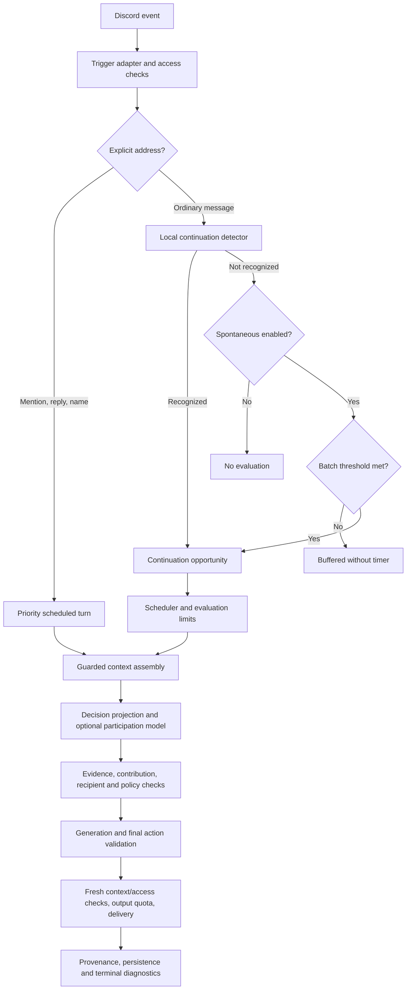

# Chat flow design review — 2026-10-21

Reviewed implementation: `a2d0bdb1`. This is a design/code review, not a new implementation or production validation. Earlier local phase acceptance remains historical evidence; it does not establish that the requested end-to-end interaction contract is complete.

## Conclusion

The shared guarded text context is useful, but its admission boundary is wrong for natural follow-ups. The system often decides whether a message is a continuation before retrieving the context needed to answer that question. A single short message can consequently receive no contextual evaluation at all. Shared context after admission is not equivalent to shared contextual interpretation for all eligible interactions.

The requested contract should be: every event eligible for automatic evaluation is either represented in a bounded contextual evaluation or receives an explicit policy/resource/cancellation disposition. This does not mean every Discord message triggers a model call, every authorized message must receive a reply, or disabling group participation enables it indirectly.

## Current flow

The diagram describes the opt-in `eligible_count` path; legacy assembly remains separate. Explicit requests do not require the optional participation model to authorize answering. Reaction events have their own scheduler and actor/target filtering before joining guarded processing.

## Findings, ordered by impact

### P1 — A single short message can wait indefinitely before context retrieval

`ProactiveChatBehavior.execute` clears the timer and returns when author-turn count, message count, and the 40-character substantive-message test are all below threshold. `maxWaitMs` is consulted only after that return. Therefore it is not a real maximum wait for all buffered events.

Live trace `8e341630-9bb1-4733-8430-8b0f37874734` confirms this path: `spontaneous`, `batch_threshold`, one message, followed by dispatch completion without a chat turn. No model had an opportunity to use history. `delayMs:0` is misleading here: it means no timer, not immediate execution.

Change: arm a bounded evaluation opportunity when the first eligible event enters the buffer. Additional events may coalesce or accelerate it, but may not reset its original maximum wait indefinitely. Quotas may defer or drop it with an explicit disposition; they must not turn it into unexplained permanent buffering.

### P1 — Local wording and short-lived cache decide semantic admission

`ChatConversationService.isImplicitlyAddressed` supplies a two-minute episode snapshot to `CharacterRuntime.couldBeAddressed`. That uses `localAddressing` plus the newer Chinese/English/Japanese personal-address heuristic. Neither has retrieved the eligible channel history at this stage. Short messages such as “好了嗎”, “然後呢”, or a reference without a second-person pronoun can miss the candidate path, especially after restart or a gap.

Change: retain these signals only as scheduling hints. A neutral automatic-message candidate should be evaluable when either continuation or group participation is enabled. After context retrieval, classify it as a follow-up, group contribution, other-person exchange, or unclear. A channel with continuation enabled and spontaneous participation disabled must still be able to discover a continuation; its final group-contribution action must remain disabled.

### P1 — The early label controls downstream policy even after richer interpretation

The provisional trigger controls eligibility, fixed target, contribution threshold, output-availability calculation, scheduler quotas, and reaction eligibility. `ConversationDecisionEngine` can resolve an older exchange from guarded evidence, but it does not migrate all those policies to the newly inferred relationship. For example, a message admitted as spontaneous can remain subject to spontaneous thresholds and output budgets even if its proposal addresses the bot. Continuation reaction-only output is explicitly disabled in preflight.

Change: distinguish immutable transport evidence from inferred intent and permitted actions. Resolve continuation/group policy after contextual classification. Calculate or reserve the applicable output budget from that validated classification; do not let the model bypass a disabled capability. State explicitly whether a continuation may use a reaction instead of text, rather than inheriting that behavior accidentally from a route label.

### P2 — The decision prompt contains conflicting instructions

`character-decision.ts` says not to label a message bot/continuing without explicit address or a recent uninterrupted same-person exchange. Later it allows older and cross-participant corrections with cited evidence. The earlier categorical prohibition can oppose the newly implemented behavior.

Change: one consistent rule: topic overlap or pronouns alone are insufficient, but explicit transport evidence or a grounded contextual relationship can establish the recipient. Timestamp gaps and speaker changes are evidence to interpret, not automatic disqualifiers. A correction that explicitly says the speaker was addressing someone else still closes the bot's exchange.

### P2 — The decision may omit context the generator could use

`projectDecisionContext` preserves reply-chain anchors and then a recent tail, independently bounded by `decisionMessages`. With no Discord reply target, an older referenced exchange retained by assembly can fall outside that tail. The model then cannot cite the evidence required for the older-continuation override.

Change: make the projection dependency-aware: current burst, explicit ancestry, relevant human/bot exchange pairs, and authorized correction/referent anchors before the ordinary tail. If essential evidence will not fit, report that gap and allow a bounded authorized expansion or clarification when appropriate. Do not silently convert “not shown to decision” into “not relevant.” The decision and generation can use different sizes but must preserve the same required evidence.

### P2 — Latency budgets do not form a complete delivery budget

Model work now has up to twelve seconds, with six seconds per attempt, separate from up to eight seconds per pre-provider context check. Assembly, other validations, generation, repair, and delivery also take time. Optional output expires thirty seconds after scheduling, and the scheduler/buffer has its own delays. A successful decision can consume most of the useful delivery window; the documented 35-second continuation pilot target is not an enforced unified budget.

Change: distinguish evaluation freshness from retrieval relevance. Track an end-to-end deadline with explicit remaining allowances for context, decision, generation, and delivery. Reserve time for output instead of allowing decision fallback to consume it all. Tune provider/model budgets from measured latency; do not solve this by removing deadlines or treating old history as stale. Source changes and new conversation events still require freshness checks.

### P2 — Context parity is currently limited to guarded text

The guarded path deliberately excludes memory, daily/derived summaries, learned character state, images, contextual tools, and profile fields. Eligible same-owner sessions, current text, channel history, ancestry, verified bot text and reaction actors have implemented handling. Legacy consumers and background producers are not all behind one mandatory gateway.

This is an explicit migration limit, not proof of a privacy leak. Nevertheless, the original “all context sources follow one rule without escape” requirement is not delivered by the current opt-in path. Re-enabling these excluded sources without provenance would be a regression.

Change: maintain a source inventory with producer, consumer, subject/audience policy, provenance, invalidation and retention requirements. Migrate sources individually through the shared guard/model boundary. Daily summaries must filter source claims and dependencies, not merely redact names after summarization.

### P2 — Diagnostics cover evaluated turns better than pre-turn candidates

The full `3334e456-9354-4de0-be62-3fd163a8af1c` trace did contain a terminal event. Its actual failure was primary timeout followed by fallback `invalid_boundary`; that specific bug is fixed in `a2d0bdb1`. Earlier excerpts were incomplete, so a stalled-turn diagnosis was not established.

The remaining diagnostic gap is candidate lifecycle. The proactive buffer exists before scheduler opportunity IDs and can return, replace a batch, or clear it without one complete per-candidate record. Preliminary legacy `selected:0` logs also appear before successful guarded assembly, making context coverage easy to misread. A raw “ignore” summary needs the nested decision failure to be interpreted correctly.

Change: stable candidate IDs, original source links, scheduled deadline, and terminal evaluated/coalesced/denied/expired/superseded/budget-dropped outcomes. Distinguish intentional silence from failure and “not evaluated.” Explain-message should expose the first causal gate and distinguish preliminary, assembled, and model-projected context counts. Never log source content or rejected model values to obtain that explanation.

## Trigger behavior contract

All rows share source authorization and provenance rules. They need comparable useful evidence, not identical prompts, latency, or mandatory replies.

| Interaction | Admission | Context interpretation | Allowed outcome policy |
| --- | --- | --- | --- |
| Direct bot mention | Explicit priority after access checks | Current text plus eligible surrounding context and referents | Answer/clarify by default; contextual social silence only if configured |
| Explicit reply to bot | Explicit priority with bounded target resolution | Reply ancestry plus eligible channel history | Answer/clarify; not restricted to reply chain alone |
| Bare ping | Explicit transport, no assumption of empty intent | Look for the speaker's pending question or referent | Address pending request; personality joke/acknowledgment/silence only when genuinely social |
| Name address | Explicit when recipient is unambiguous | Same useful context; distinguish addressing from third-person mention | Same direct intent policy, subject to enabled settings |
| Implicit follow-up | Neutral candidate; classification follows context | Eligible recent-count history, older relevant exchanges, speaker identities and corrections | Reply/react/silent according to validated continuation policy |
| Open group conversation | Same neutral candidate mechanism | Same privacy rules; detect other-person exchanges and useful group openings | Conservative optional contribution, only when group participation is enabled |
| Reactions to bot response | Target and eligible reactor snapshot, debounced | Readable target, verified provenance, relevant history and eligible actors only | Configured reaction-triggered response or silence; thresholds after actor filtering |

Do not equate permission to talk with permission to passively read all historical information. Preserve explicit restricted-role precedence, exact channel/thread scope, forget cutoffs, and public-audience restrictions. Unavailable eligibility is distinct from confirmed denial.

## Proposed processing order

1. **Ingress and hard policy:** establish source, actor, destination, direct transport evidence, enabled evaluation modes, spam/game/utility exclusions and current authorization. Do not infer conversational relevance here.
2. **Candidate lifecycle:** direct events get priority; ordinary eligible messages enter a finite buffer. Deduplicate and coalesce compatible events with explicit replacement records. Maintain original maximum-wait deadlines.
3. **Evaluation scheduling:** enforce per-channel/global concurrency, cooldowns and cost budgets. A budget rejection is a resource disposition, not a model decision to ignore someone. Preserve direct-request priority.
4. **Guarded context assembly:** retrieve last X eligible messages, relevant ancestry and authorized sources; enforce work/prompt budgets, forgetting, provenance and audience. Report coverage and unavailable classes.
5. **Contextual classification:** identify intent, response target, discussed subject, recipient, supporting source IDs and unresolved references. Time is useful metadata but not a relevance veto.
6. **Participation policy:** independently validate the proposed evidence and recipient, then apply enabled continuation/group/reaction capabilities, confidence/contribution rules and output quotas. Every failure remains distinguishable from valid silence.
7. **Generation:** use the same authorized evidence dependencies and contextual request. Personality controls expression; it does not replace an unanswered substantive request with a bare-ping joke.
8. **Delivery:** revalidate access, dependencies and target; enforce freshness, cancellation and reservations; use existing idempotent/partial-delivery handling. Do not indiscriminately retry an uncertain send.
9. **Persistence and terminal report:** retain only permitted state with provenance. Record confirmed delivery separately from generation, failure and state-commit failure.

Suggested state separation: `transportEvidence`, `evaluationDisposition`, `contextCoverage`, `inferredIntent`, `validatedAction`, and `deliveryOutcome`. Keep the policy version and evidence dependencies attached throughout. The model proposes meaning; deterministic guards retain authority over access and actions.

## Context inventory and rollout boundary

| Source | Guarded path today | Required invariant |
| --- | --- | --- |
| Current text and compatible burst | Implemented | Source/author scope and current authorization |
| Channel history | Bounded eligible-count scan and prompt budget | Exclude inaccessible authors before model exposure; report underfill |
| Reply ancestry | Bounded same-scope ancestry | Same author/source filtering; no hidden target leakage |
| Bot answers | Verified origin and dependencies | A bot paraphrase does not erase original restrictions |
| Saved sessions | Eligible same-owner exchanges with proofs | Fresh dependency validation; no duplicate copies of history |
| Reaction snapshots | Eligible target and actors | Never expose hidden text through emoji/count metadata |
| Memory and relational facts | Excluded | Subject/audience policy, provenance, retention and deletion |
| Daily/derived summaries | Excluded | Claim-level dependencies and regeneration after invalidation |
| Learned character/profile context | Excluded classes reported | Separate approved configuration from derived private facts |
| Images, attachments, tool results | Excluded in guarded text mode | Authorize source and derived outputs before every consumer |

## Implementation sequence and acceptance

1. Unify ordinary-message candidate admission and finite buffering. Test continuation-only channels and quiet channels; no pronoun/length prerequisite for evaluation. Add candidate terminal diagnostics in the same checkpoint.
2. Move semantic classification before participation-policy selection. Remove contradictory prompt rules; define continuation reaction policy; use inferred relationship for thresholds and reservations without widening configured scope.
3. Preserve required referent/exchange anchors in decision projection. Test count/budget pressure, long gaps, restart, multiple speakers and denied sources.
4. Align end-to-end deadlines and provider observability. Record actual safe model/provider identity and phase durations, and validate cancellation/late-output behavior. The current startup chat model alone does not prove the dedicated decision configuration.
5. Run real-provider replay and an explicitly scoped live pilot. Deterministic mocked-decision tests are necessary but do not measure whether the actual model recognizes intent reliably.
6. Continue the separately documented universal privacy-gateway/source migration. Keep unavailable sources excluded until their provenance contracts are implemented and tested.

Minimum acceptance cases: a single short untagged follow-up; identical “好了嗎” after a pending request versus unrelated group chat; bare ping after earlier substantive text; continuation-only with spontaneous disabled; late cross-participant correction; explicit human recipient; cold restart; permission revocation during evaluation; unreadable reaction target; summary provenance unavailable; cooldown coalescing without starvation; provider timeout/schema/source failure; successful decision near delivery expiry; direct-request preemption; and one traceable disposition per candidate.

Track evaluation coverage and false interruptions separately from reply rate. Require real-provider valid-decision/intent results by language and trigger, latency percentiles, failures before/after fallback, output suppression causes, model cost, and privacy regressions. The existing phase-5 targets remain targets, not achieved live guarantees.

## Reviewed implementation anchors

- `src/infrastructure/discord/behaviors/proactive-chat-behavior.ts`: trigger selection, buffer threshold, timer and replacement lifecycle.
- `src/infrastructure/discord/behaviors/mention-chat-behavior.ts`, `ambient-chat-behavior.ts`, `reaction-arm-behavior.ts`, `reaction-reply-scheduler.ts`: seven interaction entry points.
- `src/infrastructure/discord/behaviors/social-chat-eligibility.ts`: access, observation scope, utility origin and source gates.
- `src/application/chat/chat-conversation-service.ts`: episode-based admission hint, scheduler entry, guarded handoff, thirty-second optional expiry, delivery checks and terminal logging.
- `src/application/chat/character-runtime.ts`: decision projection, optional preparation, provisional-trigger policy and disabled legacy segmentation.
- `src/application/chat/character-decision.ts`: wording heuristic, prompt, evidence validation, confidence/contribution rules and call budgets.
- `src/application/chat/conversation-decision-engine.ts`: contextual continuation override, action policy and generation validation.
- `src/application/chat/guarded-conversation-context.ts`, `guarded-chat-turn.ts`, `eligible-channel-history.ts`: source filtering, retrieval/projection budgets, lease validation and excluded sources.
- `src/application/chat/chat-scheduler.ts`, `participation-policy.ts`: scheduling, presets, reservations and scope.
- `docs/chat-system-improvement-plan-2026-10-19.md`, `chat-context-privacy-gateway-plan-2026-10-19.md`, and incident/acceptance documents: intended contract and explicitly deferred migration.

Review limitations: static inspection plus the supplied live traces; no live settings changed, no provider calls, no production access, and no claim that every background consumer has been audited for privacy. This checkpoint changes documentation only.
