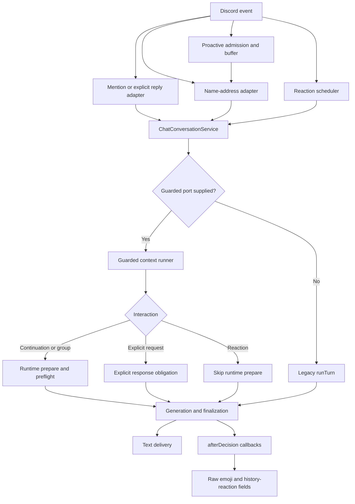

# Chat flow, common-interface and legacy-path audit

Reviewed 2026-10-21 at source commit `865b345d`. This is a code review and local reproduction report, not a production configuration audit. No production behavior, configuration or deployment was changed for this review.

Follow-up: the local repairs, real adapter-to-effect coverage, dead-code removals and final provider evidence are recorded in the [alignment ledger](chat-plan-alignment-2026-10-21.md). F1–F6 below describe the historical audited revision, not unresolved defects in the finished local implementation. Intentional legacy strategies and separate universal-source gaps remain explicitly documented. Deployment/pilot acceptance is still separate.

## Assessment

The redesign introduced useful shared components, but did not finish migrating the system to one mandatory pipeline. The current implementation is a staged compatibility architecture: a shared Discord eligibility service, an opt-in registered context lease, a shared decision engine, and multiple runners/adapters that still choose which pieces to invoke.

Consequently, “there is a common interface” is accurate for some components, but “all seven interactions must pass through the same enforced stages” is not accurate. Previous test-count and all-mode summaries were insufficient evidence for that stronger claim.

The earlier `tsx: not found` error happened before any chat pipeline ran: the source replay command requires a development dependency absent from that host. That tooling problem is separate from the routing and enforcement gaps below.

## What is shared and what remains separate

| Concern | Current state |
| --- | --- |
| Discord source/access rules | `SocialChatEligibility` is wired into production adapters; direct mentions also use a dedicated access resolver |
| Guarded source assembly | `GuardedConversationContext` filters/revalidates current text, history, ancestry, verified bot text, sessions and reaction actors when its port is supplied |
| Context runner selection | Presence of optional `guardedContextPort` selects `runGuardedChatTurn`; absence selects the much larger legacy `runTurn` |
| Decision contract | Legacy schema and contextual wire revision 3 both remain live |
| Preflight interpretation | Contextual optional messages use it; explicit requests bypass optional interpretation intentionally; guarded reaction turns skip it too |
| Final decision | `ConversationDecisionEngine.finalize` is shared, but accepts calls without a prior preflight decision |
| Visible effects | Text uses delivery guards; emoji/history reactions still use adapter callbacks inspecting response fields |
| Memory, summaries, learned state, images, tools | Excluded from guarded text prompts; other pipelines still implement these separately |
| Evaluation | Deterministic legacy-policy replay, direct character replay and contextual preflight replay test different slices |

The source types reflect this partial migration: `ChatRequest` and `ChatConversationInput` are broad structures with optional lease, callbacks and flow flags, rather than variants that require the evidence and decision appropriate to each operation. A common type does not currently make omission of a stage impossible.

## Reachable routing states

The adapters decide to supply a guarded port using `context.enabled && retrievalMode === "eligible_count"`. `contextualFlow()` additionally requires participation `flowVersion === "contextual_v1"` and no channel context-disable override. Those are different predicates.

| Context settings | Participation flow | Runner | Optional decision behavior |
| --- | --- | --- | --- |
| Disabled | Either value | Legacy | Legacy admission/decision rules where enabled |
| Enabled, legacy retrieval | Either value | Legacy | Legacy rules, even if the configured flow label says contextual |
| Enabled, eligible-count retrieval | Legacy | Guarded text | Legacy decision contract and legacy proactive admission |
| Enabled, eligible-count retrieval | Contextual, channel permitted | Guarded text | New neutral buffer and contextual preflight for continuation/group candidates |
| Enabled, eligible-count retrieval, channel context override off | Contextual selected | Adapter still supplies guarded port | `contextualFlow()` is false; passive/history eligibility blocks context use; explicit current-message handling is still separate |

See `contextual-flow.ts:4`, the port/flow predicates in `ambient-chat-behavior.ts:156–164`, and the runner selection in `chat-conversation-service.ts:856`.



Explicit mention/reply/bare-ping/name-address responses can legitimately have different response obligations from optional participation. Sharing authorization and execution does not require making explicit requests optional. Reactions, however, need an explicit policy path rather than an accidental omission of preflight.

## Findings, ordered by priority

### F1 — P1: final silent/failed actions do not fully own reaction effects

`runGuardedChatTurn` attaches the final decision, then returns a silent/react response with text cleared but leaves `reactionEmoji` and `historyReactions` present (`guarded-chat-turn.ts:96–112`). If invalid output references cause `finalize()` to return failed/silent, those reaction fields can survive.

`ChatConversationService.runScheduled` can still call `afterDecision` after lease/currentness checks; it does not require that the final decision permit reactions (`chat-conversation-service.ts:907–911`). Ambient and reaction adapters then inspect the raw emoji fields (`ambient-chat-behavior.ts:167–179`, `reaction-reply-scheduler.ts:413–423`).

Local reproduction with the actual service and a synthetic registered lease:

```json
{"status":"failed","action":"silent","emojiRetained":true,"afterDecisionObservedEmoji":true}
```

This confirms the callback is reachable, not that a production emoji was posted. Actual Discord effects additionally require eligibility and budget. Nevertheless, a final silent verdict must prohibit that effect independently of those checks. The legacy runner explicitly clears reaction fields for failed/silent output; the guarded runner lacks the equivalent normalization.

Recommended fix: make a final-action executor the sole owner of text and reaction effects. Adapters must consume an approved action, not raw model response fields. Add generation-failure and invalid-evidence tests asserting that no reaction callback can emit.

### F2 — P1: guarded reactions skip the preflight decision path

`guarded-chat-turn.ts:76` explicitly excludes `triggerMode === "reaction"` from `runtime.prepare()`. Generation and `finalize()` still run, and `finalize()` can accept optional reply output without a prior decision. The reaction snapshot has meaningful privacy/actor checks, but does not pass through the contextual recipient/intent/action assessment used by neutral text candidates.

Local reproduction with a present runtime whose `prepare()` would record an invocation:

```json
{"preflight":0,"generated":1,"delivered":1,"action":"reply"}
```

There is misleading dormant-looking code in `CharacterRuntime.prepare`: `shouldDecide` includes reactions (`character-runtime.ts:274`), but the production guarded runner never calls it for reactions. Legacy reaction execution is different because the legacy runner does call runtime preparation.

Recommended fix: define a reaction-specific normalized event and preflight contract. Do not merely remove the exclusion: the existing contextual target contract is built around human message targets, while a reaction turn targets an existing bot message and has multiple actor identities.

### F3 — P1: source citation presence is accepted as evidence of a semantic exchange link

`groundedContextContinuation()` proves that the current message and an earlier human/bot pair were cited. It does not prove that the earlier human was the current speaker or that the current speaker independently addressed/referenced the bot (`character-decision.ts:93–100`). The contextual engine uses this helper to override ambiguous local addressing (`conversation-decision-engine.ts:88–90`).

A synthetic Bob→bot exchange plus Alice's unlinked “The second one” passed that grounding helper when all three event IDs were cited. This matches the two wrong accepted cross-speaker followups already identified in the recorded provider replay.

The intended cross-speaker correction behavior is valid, so requiring the original author to always equal the current author would also be wrong. What is missing is an explicit distinction between a same-speaker exchange link and an independently established cross-speaker reference. Authorized citations alone do not establish either meaning.

Recommended fix: represent and validate those link types separately. Keep privacy/source proof separate from semantic interpretation. Calibration and independent fixture review remain necessary even with a better structural contract.

### F4 — P2: requested flow and effective route can disagree without a clear configuration error

Selecting `contextual_v1` does not by itself select the contextual route. `contextualFlow()` returns false when context is disabled, retrieval remains legacy, or the channel context override is off. The proactive adapter then continues into legacy admission, including the short-message threshold branch (`proactive-chat-behavior.ts:65–70, 88–112`). That legacy branch can leave an isolated short spontaneous message below the threshold with no timer scheduled.

The policy overview prints the configured participation flow (`settings/groups/chat-policy-report.ts:14`). It separately reports context state, but does not resolve and display the exact effective pipeline or a contextual-flow precondition failure. Most setting writers store the requested flow without validating its context prerequisites.

Local reproduction:

```json
{"configured":"contextual_v1","contextualRoute":false}
```

Recommended fix: resolve one authoritative turn plan, report requested versus effective mode and its reasons, and make incompatible configuration explicit. Preserve intentional legacy support, but do not present silent fallback as successful contextual activation.

### F5 — P2: guarded and legacy lifecycle implementations can drift

`chat-conversation-service.ts:856` chooses between `runGuardedChatTurn` and `runTurn` (`:1031`). Both implement generation, finalization, attribution repair, silence handling and delivery-related state. Their behavior already differs in F1/F2. Recent grounded-confirmation fixes also required edits in the engine, generator handoff and finalization rather than one complete operation.

The outer thirty-second deadline additionally depends on flags supplied by adapters (`chat-conversation-service.ts:753`). A guarded lease alone does not select that total deadline. Guard phases retain their own bounds, but that is not the same guarantee as the total-turn budget.

Recommended fix: share lifecycle/execution machinery and keep source strategy and explicit/optional obligations as typed variants. “One interface” should mean one enforced owner per invariant, not one large object carrying many optional ways to select behavior.

### F6 — P2: tests and replay gates cover slices rather than routing equivalence

The seven-mode matrix in `guarded-chat-turn.test.ts:204` toggles a `contextual` value, but its setup always supplies `guardedContextPort` (`:57`). Both values therefore use the guarded runner; the false value exercises a legacy decision configuration inside that runner. It does not cover both runners through actual adapter routing. Its reaction cases assert generation/context delivery, not entry into preflight.

Proactive tests replace the ambient adapter with a spy. They correctly test candidate admission and buffering, but stop before real context assembly, interpretation and output. Other suites cover many of those components independently; they do not establish that every real entry route composes them identically.

The contextual live replay uses actual preflight policy with synthetic authorization, but bypasses Discord ingress, scheduling, generation and delivery. Its 99% gate measures decision validity. It records semantic/required-reply failures without making them fail that gate. Different-speaker answer fixtures also permit text, allowing wrong followups to escape the narrow text-policy counter (`contextual-replay.ts:35–38`, `contextual-replay-policy.ts:41–43`).

The older `eval:character-replay --participation-fixture` uses a separate deterministic helper and supplied fake model output, not the current production lifecycle (`participation-evaluation.ts:12–28`). The ordinary character replay uses direct turns without guarded ports. Both can remain useful, but need explicit scope labels and must not be substituted for current-flow acceptance.

Recommended fix: add a route-to-effect contract suite covering each mode/configuration and observable stage invocation. Require semantic and effect-safety gates separately from schema validity. Correct fixture expectations under a declared revision rather than silently rewriting past metrics.

## Dead code, compatibility code and older tests

These categories must not be mixed. A default-live legacy path is not dead because a replacement exists.

| Candidate | Repository evidence | Classification / treatment |
| --- | --- | --- |
| `ChatTurnSupport.createHistoricalContextRefresh` and its private implementation (`:180–211`) | Only a test invokes the public factory; no production adapter wires its callback into the service | Unwired migration residue; remove with its hook or deliberately migrate callers |
| `ChatConversationInput.refreshHistoricalContext` (`chat-conversation-service.ts:187`) and related expanded-refresh branches | Test inputs set it; production callers do not | Test-only reachable service path under current wiring; migrate privacy assertions to the registered lease before deleting |
| `resolveChannelHistory(..., countFirst=true)` (`chat-turn-support.ts:366`) | Three production adapters call history only when eligible-count guarded mode is false, then pass that same predicate as `countFirst` | Production-unreachable true branch with current adapters; directly exercised by `chat-turn-support-history.test.ts` |
| `collectEligibleHistory` | Used by the above branch and directly tested; guarded lease has its own bounded scan | Helper supporting a dormant production branch; `budgetEligibleHistory` is separately live and must be retained |
| `CharacterDecisionService.decide()` (`character-decision.ts:226`) | Production runtime/replay callers use `evaluate()`; the convenience wrapper is called by a test | Test-only wrapper candidate; remove only after confirming the intended public API boundary |
| `AddressingModule` | Empty registered class with an explicit compatibility comment | Deliberate compatibility shell, not an active decision owner; retire/migrate its settings deliberately |
| `addressing.includeOtherParticipants` | Exposed as a setting and passed into `localAddressing`, whose parameter is `_includeOthers` and unused (`character-decision.ts:125`) | Ineffective setting; deprecate/remove or implement/document current semantics |
| `CharacterModule.onDecision` return `allowed` | Registry ignores the flag and returns `allowed:true` (`character-module-registry.ts:50–56`) | Obsolete authority field; simplify the hook to context contribution rather than suggesting it can authorize/veto |
| Legacy schema, old segmentation, legacy proactive buffer | Defaults and rollback can still select them | Live compatibility paths; cannot delete tests or code without a migration/retirement decision |
| `allowsOptionalParticipation` | Used by deterministic legacy-policy replay and older tests | Offline compatibility logic, not dead and not the current complete policy oracle |

The true `countFirst` branch is not merely untested production behavior: its existing tests invoke it directly despite current adapters never doing so. Conversely, legacy short-message threshold tests remain valid for a route that is still selectable. Rename/group them by compatibility scope instead of deleting them because they contradict contextual expectations.

## Rich-context migration is still incomplete by design

Guarded turns explicitly use empty memory/guild-knowledge/profile-derived arrays and disable images/tools. They log excluded sources (`guarded-chat-turn.ts:42–44, 59–72`). This is the correct fail-closed posture for sources without complete authorization/provenance migration, but it is not the originally desired universal rich-context implementation.

Background history/daily-summary readers, memory recall/consolidation and character evaluation/probes have their own paths. The background Discord reader uses shared eligibility, but not the same registered prompt lease. Probes invoke the reply provider directly and are not Discord delivery paths. Their different purposes should remain explicit rather than pretending every provider call is a normal chat turn.

No new unauthorized-read exploit was established in this review. F1 is a final-action enforcement defect; F2 is a decision-stage inconsistency; F3 is semantic grounding weakness. These findings must not be conflated with proof that all context privacy checks are bypassed.

## Recommended repair order

1. **Close the effect boundary:** suppress every text/emoji/history reaction disallowed by the final decision. Reproduce F1 with actual adapter callbacks and test no visible effect after failed/silent outcomes.
2. **Resolve one turn plan:** derive effective flow, context strategy, obligations and deadlines once from normalized event plus current policy. Make invalid combinations explicit; stop using optional field presence as policy selection.
3. **Give reactions an explicit preflight contract:** represent the bot target and authorized reactor actors correctly, then join the common lifecycle. Preserve intentional explicit-request behavior.
4. **Separate semantic exchange links from source proof:** address cross-speaker inheritance and measure missed replies without lowering thresholds to hide uncertainty.
5. **Move safety tests onto real wiring:** verify adapter→scheduler→context→decision→generation→effect seams, including cold replies, changed settings, shadow, failure and every mode. Keep focused unit tests as supporting evidence.
6. **Remove proven migration residue:** delete unwired refresh hooks/branches and obsolete fields in a dedicated checkpoint, with replaced safety assertions and clearly labelled legacy suites/evaluators.
7. **Finish universal source migration separately:** require authorized provenance for each source type before enabling it in guarded prompts. Retire legacy only after migration and acceptance, not because a new interface name exists.

Shared interfaces can guarantee that required authorization and effect checks cannot be omitted. They cannot by themselves guarantee correct language interpretation. Both enforcement and semantic acceptance need evidence.

## Verification performed

- Production TypeScript build succeeded from current sources.
- Full suite: **4,796 passed / 7 skipped**, **357 passed test files / 7 skipped**. The skipped suites are database-dependent contract/integration suites, not newly skipped chat tests.
- Four synthetic reproductions passed against compiled current implementations: reaction preflight omission; failed/silent output reaching a raw-emoji callback; configured/effective flow mismatch; and foreign-speaker citation grounding.
- No real Discord sends, provider/API requests, deployment or production settings changes occurred.
- Review changes are documentation only. The defects above remain unfixed at this checkpoint.
